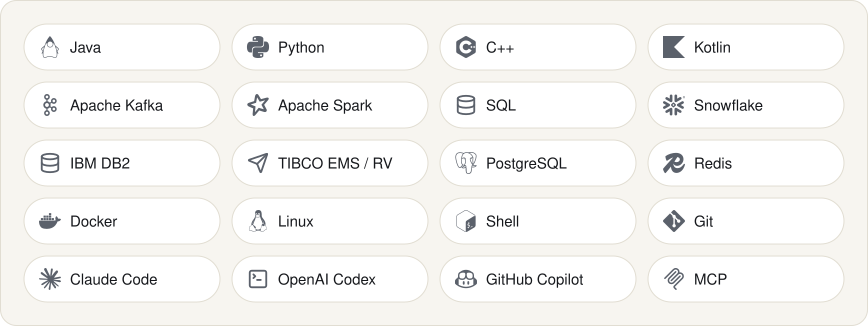
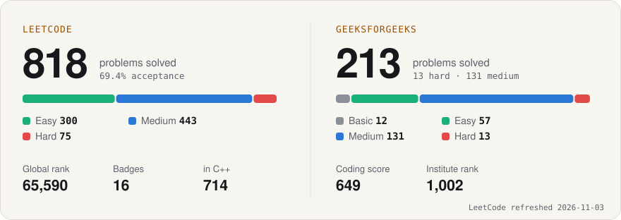

<a href="https://architsingh5.github.io">
  <picture>
    <source media="(prefers-color-scheme: dark)" srcset="assets/banner-dark.svg">
    
  </picture>
</a>

  <a href="https://architsingh5.github.io"><b>Portfolio</b></a> ·
  <a href="https://www.linkedin.com/in/architsingh5">LinkedIn</a> ·
  <a href="https://leetcode.com/u/architsingh5/">LeetCode</a> ·
  <a href="https://www.geeksforgeeks.org/profile/architsingh5">GeeksforGeeks</a> ·
  <a href="https://x.com/ArchitSingh51">X</a>

### What I work on

I'm a backend engineer at **Goldman Sachs** (since 2023) working on systems that carry trades through orders, executions and clearing.

- **Throughput.** Striped ICE EU and NYMEX trade ingestion across three load-balanced hosts, cutting primary-host load by **54%** and **64%**.
- **Pipelines.** Java/Kafka data-hydration pipelines that feed a GCP-backed OLTP store and a Snowflake lakehouse, with a transactional outbox for reliable delivery between services.
- **Platform.** Moved firmwide mapping rules from static definitions into a database, cutting rule-change turnaround from **7 days to 1**. Profiled query paths for **75%** faster dashboards.

The [portfolio](https://architsingh5.github.io) shows a trade moving through that pipeline as you scroll.

### Things I've built

| Project | What it is | Stack |
|---|---|---|
| [**Market Data MCP Server**](https://github.com/architsingh5/mcp-market-data-server) | Ask Claude or any MCP client plain-English questions about two years of Indian equity end-of-day data (1.06M daily prices, 2,816 instruments). Deployed, with CI. | Python · MCP · PostgreSQL · Redis · Docker |
| [**Water Reminder**](https://github.com/architsingh5/Water-Reminder) | Native Android app with confirmation-based scheduling, streaks, a home-screen widget and alarm-style alerts that survive reboots and timezone changes. | Kotlin · Jetpack Compose · AlarmManager |
| [**Fuzzy Traffic Control**](https://github.com/architsingh5/fuzzy-traffic) | Fuzzy-logic traffic lights for a four-way junction, simulated in SUMO and benchmarked against fixed-time control. | Python · SUMO · pytest |
| [**MouseTrail**](https://github.com/architsingh5/MouseTrail) | Windows overlay that draws glowing light trails behind the cursor, with tray controls and an installer. | Electron · JavaScript · Canvas |
| [**Portfolio**](https://github.com/architsingh5/architsingh5.github.io) | This profile's big sibling: a static site with a scroll-driven pipeline story and weekly auto-refreshed stats. | HTML · CSS · JS · GitHub Actions |

### Toolbox

<picture>
  <source media="(prefers-color-scheme: dark)" srcset="assets/toolbox-dark.svg">
  
</picture>

### Problem solving

<a href="https://leetcode.com/u/architsingh5/">
  <picture>
    <source media="(prefers-color-scheme: dark)" srcset="assets/solving-dark.svg">
    
  </picture>
</a>

LeetCode numbers refresh every Monday through a GitHub Action in this repo.

---

  B.Tech CSE, MANIT Bhopal (2023) · Open to backend and distributed-systems conversations through the <a href="https://architsingh5.github.io/#contact">contact form</a>.

